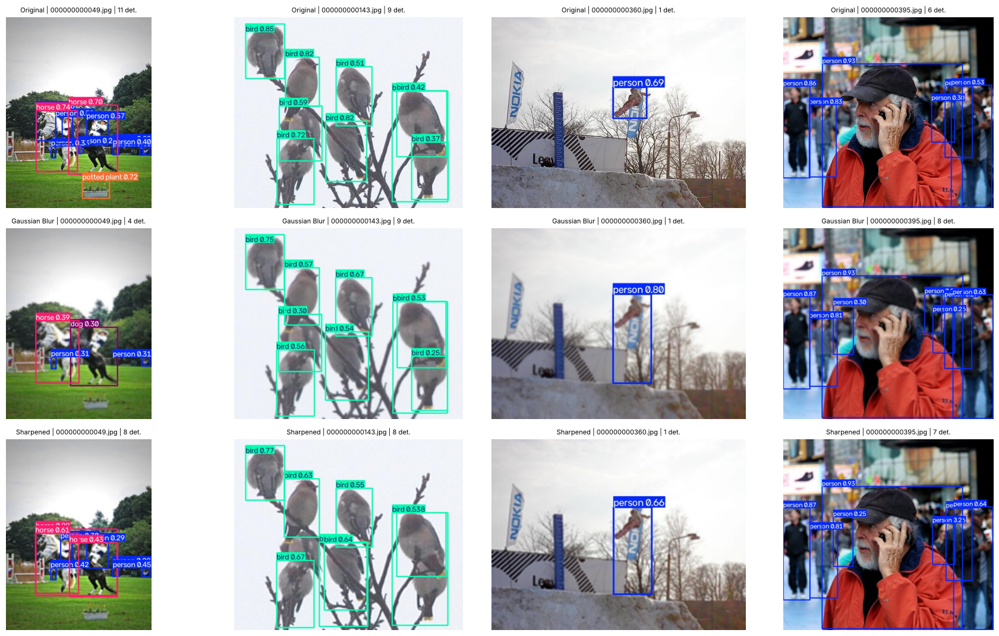

# Effect of Blur and Sharpening on Object Detection (YOLO11n on COCO128)

Individual mini project for *Foundations of Vision and Language*.
A pretrained **YOLO11n** (no retraining) is evaluated on COCO128 in three stages:

1. **Original** images (baseline)
2. **Gaussian blur** – `cv2.GaussianBlur(img, (9, 9), 0)` on every image
3. **Sharpened** – unsharp masking applied to the blurred images
   (`sharpened = (1 + 1.5)·img − 1.5·GaussianBlur(img, σ=1.5)`)

Labels are unchanged across stages; validation settings are identical
(`imgsz=640, conf=0.001, iou=0.6`, 128 images, 929 instances).

## Results

| Stage | Precision | Recall | mAP@0.5 | mAP@0.5:0.95 |
|---|---:|---:|---:|---:|
| Original / Baseline | 0.6964 | 0.5864 | 0.6771 | 0.5006 |
| Gaussian Blur | 0.7012 | 0.5337 | 0.6235 | 0.4401 |
| Sharpened | 0.6574 | 0.5556 | 0.6375 | 0.4606 |

| Change | Precision | Recall | mAP@0.5 | mAP@0.5:0.95 |
|---|---:|---:|---:|---:|
| Blur vs Original | +0.0048 | -0.0526 | -0.0536 | -0.0604 |
| Sharpened vs Blur | -0.0438 | +0.0218 | +0.0140 | +0.0204 |
| Sharpened vs Original | -0.0390 | -0.0308 | -0.0396 | -0.0400 |

## Key findings

- Blur mainly costs **recall** and **localisation** (largest drop in mAP@0.5:0.95); precision is unchanged.
- Sharpening recovers part of the loss (recall, mAP@0.5, mAP@0.5:0.95 all improve) but
  **precision drops** (-0.0438) because noise and edge halos create extra detections.
- Nothing returns to the baseline, so sharpening is a partial fix, not a full restoration.

## Prediction examples

Rows: Original, Gaussian Blur, Sharpened. Columns: 4 fixed example images.



Individual outputs are in `results/predictions/<stage>/`; raw metrics are in `results/results.json`.

## Reproduce

```bash
pip install -r requirements.txt
jupyter notebook notebooks/FoVL_Individual_Project_CV.ipynb   # or upload to Google Colab
```

The notebook downloads COCO128 and `yolo11n.pt` automatically.

## Notes / limitations

- COCO128 has a single split, so the same images are used for validation.
- Sharpening parameters (σ=1.5, amount=1.5) were not tuned.
- Images are re-encoded as JPEG at each stage; single run, so small differences should be read cautiously.
